# ClipAtlas

**把海量视频素材，变成可理解、可检索、可编导、可替换、可继续精剪的创作资产。**

[中文](#中文) · [English](#english) · [项目源码](https://github.com/xinsen854/ClipAtlas) · [Hypit 开源项目](https://github.com/hypit-ai/hypit)

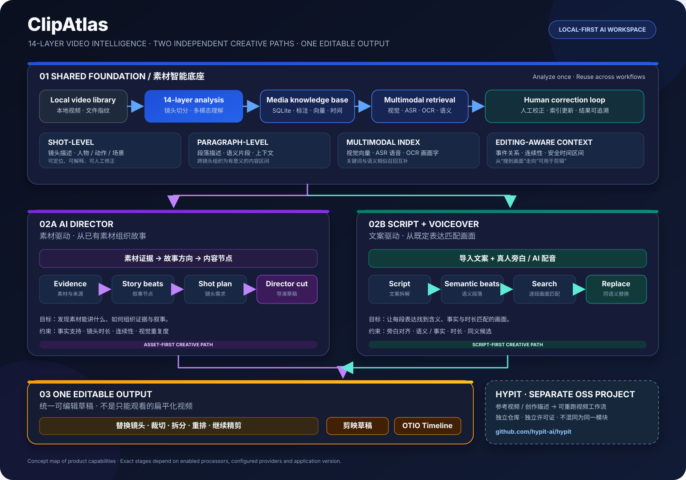

ClipAtlas 是一个 **Local-first AI 视频素材理解与智能剪辑工作台**。它不止给视频贴标签，也不止把文案交给模型生成一条“看起来像视频”的结果；它先把本地素材解析成可检索的多层语义资产，再让 AI 导演或已有文案与旁白分别驱动两条创作链路，最终生成**可替换、可裁切、可拆分、可继续编辑的剪辑草稿**。

> **核心理念：素材理解与创作编排分离；AI 负责理解、检索和规划，人始终保留替换与精剪的控制权。**

---

## 中文

## ClipAtlas 能做什么？

- **14 层画面理解体系**：从媒体结构、镜头边界和代表帧，到画面内容、主体与动作、场景语义、OCR、ASR、向量检索、段落语义和时间关系，建立不止于“一个视频一段描述”的素材理解基础。
- **镜头级 + 段落级画面描述**：既能定位具体镜头，也能把跨镜头的连续内容组织为具有语义、时间范围和上下文的段落级片段。
- **自然语言与多通道检索**：结合视觉语义、AI 标注、语音转录和画面文字寻找素材；结果可回到原视频的准确时间范围。
- **人工校正闭环**：修正 AI 对人物、动作、场景或画面含义的理解，让修正结果进入后续素材检索，而不是停留在一次性的备注里。
- **AI 导演工作流**：从已有素材中组织证据、梳理故事方向与内容节点，再据此规划画面和剪辑结构。
- **文案 + 旁白工作流**：导入已有文案和 AI 配音/真人旁白，拆解语义段落与画面需求，检索匹配镜头，并为同一语义意图寻找可替代素材。
- **同语义替换**：镜头不合适时，可以寻找承担相同叙事功能的替代画面；目标不是“找一段看起来差不多的视频”，而是在尽量保持语义意图的前提下替换素材。
- **可编辑草稿输出**：两条创作链路最终都进入可继续调整的剪辑草稿，支持素材替换、裁切、拆分与时间线调整，并可导出剪映草稿或 OpenTimelineIO（OTIO）时间线。
- **本地优先与局域网素材共享**：素材文件与目录索引以本地工作流为核心；可在局域网内向其他设备提供只读搜索和预览，无需复制整个素材库。
- **Hypit 视频工作流集成**：通过独立的开源项目扩展参考视频驱动的工作流复刻、视频变体与可重跑的视频制作能力。

## 一张图看懂整个工作流

ClipAtlas 的关键设计不是一条从“视频 → 文案 → 剪辑”的直线，而是 **一个共享的素材智能底座 + 两条彼此独立的创作链路 + 一个统一的可编辑草稿出口**。

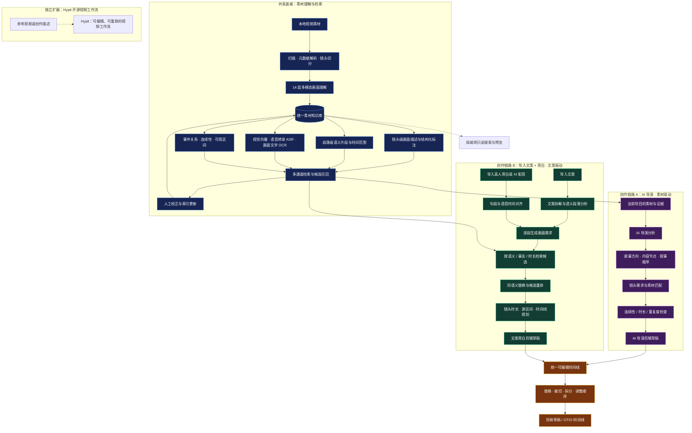

**两条创作链路不是同一个入口，也不要求互相依赖：**

- **AI 导演链路**以素材库中的真实画面和素材证据为起点，组织内容方向、故事节点和叙事顺序，再匹配镜头、规划剪辑。
- **文案 + 旁白链路**以用户已经写好的文案和旁白为起点，先分析文案，再对齐语音时间，逐段检索、筛选和替换画面。

它们共享底层素材库、语义检索和时间线能力，但创作起点与决策流程不同。两条链路最终都汇入同一个可编辑草稿阶段，而不是直接把一段不可修改的 MP4 当作唯一结果。

## 14 层画面理解：从“看见画面”到“知道怎么用”

ClipAtlas 的画面解析不是单次调用模型后只保存一句 caption，而是从媒体结构、视觉语义、文字与语音信息，到可剪辑的时间关系，建立多层理解与索引。以下是产品能力视角的 14 个层次：

| 层级 | 理解对象 | 作用 |
|---|---|---|
| 01 | 媒体结构与元数据 | 识别文件、时长、分辨率、帧率和音视频基本属性 |
| 02 | 镜头边界 | 将长视频切分为更易分析和定位的镜头片段 |
| 03 | 代表帧与时间采样 | 为镜头建立可复用的视觉证据 |
| 04 | 画面整体描述 | 用自然语言描述主要视觉内容与画面发生的事情 |
| 05 | 人物、主体与物体 | 识别画面中的关键对象及其关系线索 |
| 06 | 动作与事件 | 理解人物或物体在做什么、发生了什么 |
| 07 | 场景与环境 | 组织地点、环境和上下文语义 |
| 08 | 情绪、氛围与视觉表现 | 支持情绪表达、画面气质和创作意图相关的检索 |
| 09 | 画面文字 OCR | 提取屏幕、标牌、字幕等可见文字信息 |
| 10 | 语音转录 ASR | 将语音内容转化为可检索的文本线索 |
| 11 | 镜头级语义描述 | 让单个镜头成为可搜索、可解释的语义资产 |
| 12 | 段落级语义片段 | 将有意义的连续画面组织为较完整的叙事片段 |
| 13 | 多模态语义索引 | 结合文本与视觉向量，支持不同说法之间的语义匹配 |
| 14 | 时间、连续性与可用性 | 管理事件先后、连续关系、可用区间及剪辑约束 |

> 这 14 层是面向用户的能力分层，不代表 14 个独立模型必须逐一串行调用。实际生成哪些索引，取决于素材内容、启用的处理阶段与已配置的 AI 服务。不同层之间互相补充：文本描述便于理解，结构化标签便于筛选，向量便于语义召回，时间结构则负责把结果转成真正能用于剪辑的片段。

## 段落级语义：不把每个镜头当成孤岛

传统素材管理通常按文件名、时间码或单个镜头管理内容。ClipAtlas 同时保留镜头级索引，并尝试把相关镜头组织成段落级语义片段。

这让检索不必只回答“哪个镜头出现过汽车”，而能进一步围绕一段内容的上下文、动作变化、时间范围与连续性来找素材。对自动编导和粗剪而言，这很重要：**剪辑需要的不只是单帧相似，而是有明确含义、长度合适、边界可控的画面区间。**

## 智能检索：不只靠关键词

ClipAtlas 将多种检索线索组织到同一素材工作流中：

- **视觉语义检索**：通过视觉向量召回画面内容相近的片段。
- **标注语义检索**：基于镜头描述与语义向量查找表达相近的画面。
- **ASR 语音检索**：按视频中实际说出的内容查找相关片段。
- **OCR 文字检索**：按画面中出现的字幕、标题或其他可见文字检索。
- **混合召回与排序**：合并多种检索通道的候选，再结合来源、匹配证据和剪辑约束进行筛选。

搜索结果不仅返回一个文件名，也会保留源视频、命中时间段和相关证据，方便用户直接查看、播放、校正并用于下一步剪辑。

## 同语义替换：让剪辑不被第一个结果绑死

当某个镜头与段落含义相符，却在构图、节奏、时长或视觉重复上不合适时，ClipAtlas 的创作流程可以继续寻找语义相近或承担相同叙事功能的候选素材。

理想的替换过程会综合考虑：

- 该段文案或叙事节点真正需要表达的含义；
- 主体、动作、场景与事实要求；
- 原视频可用的起止时间及目标时长；
- 与前后镜头的连续性、视觉重复和剪辑节奏。

因此，“同语义替换”不是简单地把一个结果换成另一个相似度较高的结果，而是尽量保留该段在叙事中的作用，同时让作者仍能控制最终选用的画面。

## 两条独立的创作链路

### A. AI 导演：从已有素材出发，组织故事

适合还没有完整成稿、希望先看现有素材能讲什么故事，或想让 AI 帮助整理内容结构的场景。

1. 从当前项目的已索引素材中建立证据集合。
2. AI 导演分析素材证据，形成故事方向、内容节点或大纲。
3. 根据叙事节点确定画面需求与素材匹配关系。
4. 对候选片段进行时间、连续性和重复度检查。
5. 生成可继续调整的剪辑草稿。

AI 导演的出发点是 **“我手里有什么素材，这些素材能怎样组织成内容？”** 它不等同于导入一份现成文案后进行逐句配画面。

### B. 导入文案 + 旁白：从既定表达出发，匹配画面

适合已经写好文案、录好真人旁白或生成 AI 配音，希望系统完成素材匹配和粗剪的场景。

1. 导入文案，并导入或选择对应的旁白轨道。
2. 拆解文案中的语义段落、表达意图与画面需求。
3. 结合旁白时长或时间信息，确定每段画面的节奏与目标时长。
4. 从素材库中检索视觉、语音、OCR 与语义标注候选。
5. 对候选进行事实与语义匹配、时长筛选和同语义替换。
6. 规划源素材入点/出点和目标时间线位置，生成粗剪草稿。

这条链路的出发点是 **“我要表达什么，应该用哪些画面来表达？”** 文案与旁白是创作输入，不会被 AI 导演链路取代；它可以独立完成从文本、语音到剪辑草稿的流程。

## 从草稿到真正可编辑的剪辑工程

ClipAtlas 把 AI 生成的时间线定位为**剪辑初稿，而不是不可修改的最终成片**。草稿生成后，用户仍可根据创作需要：

- 替换某个镜头或寻找同语义候选；
- 调整片段的源视频入点与出点；
- 裁切、拆分或重新安排镜头；
- 调整镜头顺序与时间线安排；
- 在进入专业剪辑软件后继续精剪。

当前项目提供剪映草稿与 OpenTimelineIO（OTIO）相关导出能力。实际可用的导出后端与兼容性取决于安装的依赖、所选模式及目标软件版本。

## Hypit：独立开源的视频工作流系统

ClipAtlas 还集成了独立的 **Hypit** 工作流。Hypit 不是 ClipAtlas 的另一种剪辑模式，而是一个单独维护的开源项目：它为 AI Agent 提供视频制作工作流，可以从参考视频或文字描述出发，组织画面、字幕、B-roll、特效和可复用的制作步骤，并产出可编辑、可重新运行的工作流，而非只有一次性的渲染结果。

- **Hypit 源码仓库**：[github.com/hypit-ai/hypit](https://github.com/hypit-ai/hypit)
- **Hypit 中文说明**：[README.zh-CN.md](https://github.com/hypit-ai/hypit/blob/main/README.zh-CN.md)
- **Hypit 许可证**：[LICENSE](https://github.com/hypit-ai/hypit/blob/main/LICENSE)

Hypit 使用自己的开源许可证，其条款与 ClipAtlas 的 AGPLv3-or-later + 单独商业授权模式并不相同。Hypit 当前许可证基于 Apache 2.0 并附加额外条件；对于多租户托管服务和面向第三方的商业再分发等用途，需仔细阅读官方许可证并在需要时取得单独商业授权。不要把 Hypit 的授权范围理解为自动继承 ClipAtlas 的授权，也不要把 ClipAtlas 的许可证当作 Hypit 的许可证。

## 本地优先、可配置 AI 服务

ClipAtlas 以本地素材目录和本地数据库为基础，减少对中心化素材库的依赖。部分 AI 能力可通过配置的模型/API 服务完成；是否使用外部服务、哪些阶段会发送媒体或文本数据，取决于启用的 Provider 与实际处理流程。**本地优先不等于所有 AI 分析都默认完全离线**。请在使用前确认所配置服务的隐私政策、数据传输范围与费用。

## 软件截图

以下为从实际运行的 ClipAtlas 界面截取的画面，覆盖素材管理、多模态解析、AI 辅助创作与粗剪工作流。

### 工作台与画面分析

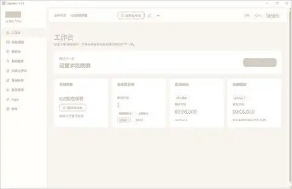

主工作台与项目工作区。

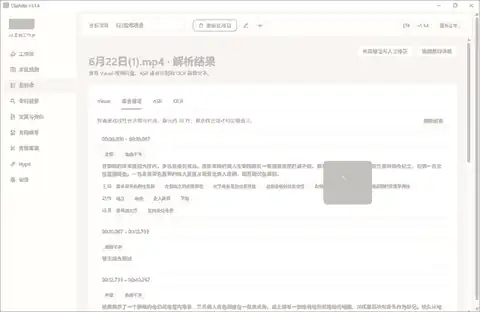

查看视频画面分析结果。

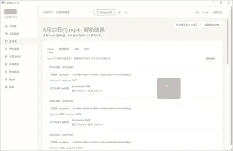

视觉索引与素材检索相关界面。

### OCR 与语音识别

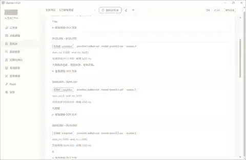

OCR 相关处理界面。

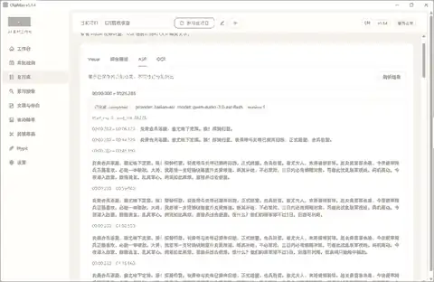

语音识别（ASR）相关处理界面。

### AI 导演与文案/旁白

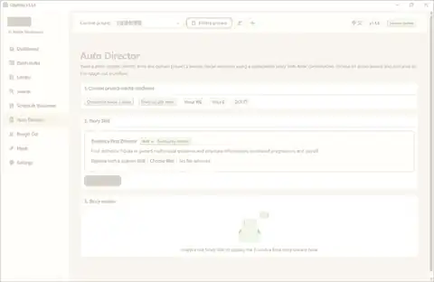

AI Director 页面，保留了其实际运行时的英文界面。

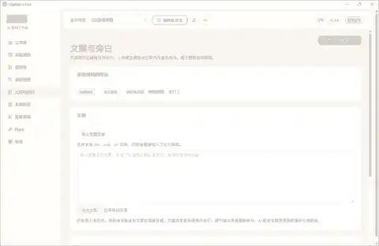

文案 / 旁白相关创作界面。

### 粗剪与 Hypit 工作流

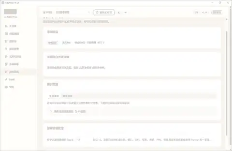

粗剪相关工作区。

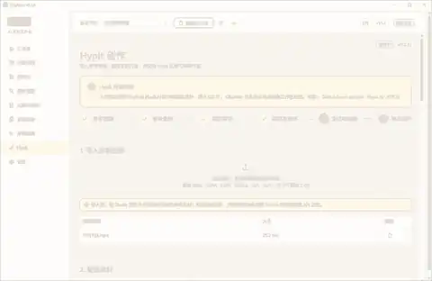

Hypit 相关工作流界面。

工作流示意图另见 [workflow.svg](docs/screenshots/workflow.svg)。

## 技术组成

- **后端**：Python、FastAPI
- **前端**：React
- **素材与索引存储**：SQLite、本地文件系统
- **媒体处理**：FFmpeg / ffprobe、镜头检测与帧提取
- **AI 能力**：可配置的视频理解、文本/视觉嵌入、ASR、OCR、TTS 与候选重排 Provider
- **导出**：OpenTimelineIO、剪映草稿后端（依赖与模式需按实际环境配置）

## 从源码运行

### 环境要求

- Python 3.12+
- Node.js / npm
- FFmpeg 与 ffprobe
- 对所启用的 AI 功能，准备相应 Provider 的 API Key 与配置

### 安装与启动

```powershell
cd frontend
npm ci
npm run build
cd ..
pip install -e ".[dev]"
clipatlas
```

首次启动后，在软件设置中填写所需的 AI API Key。不同的 AI 功能有各自的启用条件；未配置的 Provider 不会自动获得对应能力。本仓库不包含用户的 API Key、本地视频、数据库、便携运行数据或 Hypit 工作区。

Windows 安装包和版本信息请查看 [Releases](https://github.com/xinsen854/ClipAtlas/releases)。

## 许可证与第三方声明

### ClipAtlas

ClipAtlas 原创代码采用 **GNU Affero General Public License v3.0 或更高版本（AGPLv3-or-later）+ 单独商业授权** 的双许可模式。

- 开源使用请遵守仓库中的 [LICENSE](LICENSE)。分发修改版或通过网络向用户提供修改版服务时，请履行适用的源代码提供、版权声明和其他许可证义务。
- 如需闭源集成、闭源分发或其他 AGPL 例外，请联系版权所有者另行签署商业许可。具体条款见 [COMMERCIAL_LICENSE.md](COMMERCIAL_LICENSE.md)。
- 第三方组件仍按各自原始许可证授权，详见 [THIRD_PARTY_NOTICES.md](THIRD_PARTY_NOTICES.md)。

### Hypit

Hypit 是单独的开源项目，使用自己的许可证。使用、修改、再分发或提供托管服务前，请直接阅读 [Hypit 官方许可证](https://github.com/hypit-ai/hypit/blob/main/LICENSE)。两项目的许可条款相互独立。

## 参与与反馈

欢迎通过 GitHub Issues 提交问题、功能建议和可复现的错误报告，也欢迎贡献代码与文档。

- [报告问题 / 提交建议](https://github.com/xinsen854/ClipAtlas/issues)
- [项目源码](https://github.com/xinsen854/ClipAtlas)
- [Hypit 开源项目](https://github.com/hypit-ai/hypit)

---

## English

**Turn large video libraries into searchable, understandable, director-ready, replaceable editing assets.**

ClipAtlas is a **local-first AI video understanding and editing workspace**. It indexes local footage, builds multi-layer visual and semantic representations, searches across visual content, speech and on-screen text, and turns either an asset-driven AI Director workflow or a script-and-voiceover workflow into an **editable rough-cut project**.

Its core idea is simple: **separate media understanding from creative orchestration**. AI helps understand, retrieve and plan; creators retain control over shot replacement, trimming, splitting and final editing.

### Two independent creative workflows

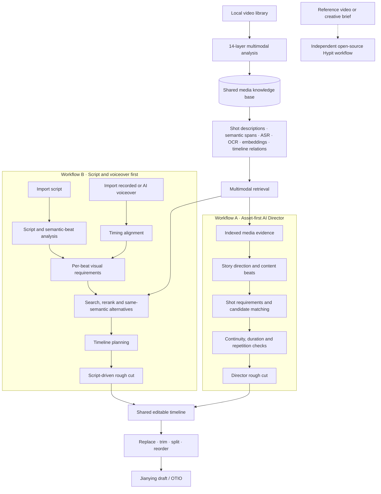

**Workflow A — AI Director, asset-first:** starts from indexed footage and its evidence, then organizes story direction, content beats, shot requirements and edit structure.

**Workflow B — script + voiceover, script-first:** starts from an existing script and recorded or generated narration, analyzes semantic beats, aligns timing, retrieves footage, finds same-semantic alternatives and plans the timeline.

The two workflows share the media knowledge base and editing infrastructure, but have different starting points and decision paths. Both can produce a draft that remains editable; neither is limited to exporting a flattened, final-only video.

### Fourteen-layer media understanding

ClipAtlas organizes media understanding across 14 product-level layers: media metadata, shot boundaries, frame sampling, global visual descriptions, subjects and objects, actions and events, scenes and environments, mood and visual style, OCR, ASR, shot-level semantic descriptions, paragraph-level semantic spans, multimodal semantic indexing, and timeline continuity/usable ranges.

These are capability layers, not a claim that every file must invoke 14 independent models in a fixed sequence. The available outputs depend on media content, enabled processing stages and configured providers.

### Key capabilities

- **Shot-level and paragraph-level understanding:** retrieve individual shots as well as meaningful spans with context and time ranges.
- **Multimodal search:** combine visual semantics, annotations, ASR transcripts and OCR text; return results tied to source-video timecodes.
- **Human correction loop:** corrections to AI annotations can inform later searches.
- **Same-semantic replacement:** find alternatives that preserve a beat's intent while considering subject, action, scene, duration and continuity.
- **Editable rough cuts:** replace, trim, split and rearrange clips before exporting a Jianying draft or OpenTimelineIO timeline.
- **Local-first library:** keep media and the main catalog local, with optional read-only LAN search and preview.
- **Independent Hypit integration:** use the open-source Hypit workflow for reference-driven video creation, reusable variants and editable, rerunnable compositions.

### Screenshots

The images below are captures from the running ClipAtlas application, covering the workspace, multimodal analysis, AI-assisted creation and rough-cut workflow.

#### Workspace and visual analysis


Main workspace and project view.


Video-frame analysis view.


Visual indexing and media discovery interface.

#### OCR and speech recognition


OCR-related processing interface.


Automatic speech recognition interface.

#### AI Director and script/voiceover


AI Director interface, shown in its original English UI.


Script and voiceover workflow interface.

#### Rough cut and Hypit workflow


Rough-cut workspace.


Hypit-related workflow interface.

See also the [workflow diagram](docs/screenshots/workflow.svg).

### Technology

Python, FastAPI, React, SQLite, FFmpeg/ffprobe, configurable AI providers, OpenTimelineIO and a Jianying export backend (availability depends on installed dependencies and selected mode).

### Run from source

Requirements: Python 3.12+, Node.js/npm, FFmpeg and ffprobe, plus API credentials for the AI providers you enable.

```powershell
cd frontend
npm ci
npm run build
cd ..
pip install -e ".[dev]"
clipatlas
```

Enter the required API keys in Settings. Local-first does not mean every AI operation is automatically offline; external processing depends on the configured providers and workflow.

### Hypit is a separate open-source project

Hypit provides an agent-oriented video production workflow that can start from a reference video or a creative brief and produce editable, rerunnable compositions. It is maintained separately from ClipAtlas.

- Source: [hypit-ai/hypit](https://github.com/hypit-ai/hypit)
- Chinese README: [README.zh-CN.md](https://github.com/hypit-ai/hypit/blob/main/README.zh-CN.md)
- License: [Hypit License](https://github.com/hypit-ai/hypit/blob/main/LICENSE)

Hypit has its own license, based on Apache 2.0 with additional conditions. In particular, hosted multi-tenant services and commercial redistribution can require separate written authorization. Read the upstream license; Hypit's terms are distinct from ClipAtlas's license.

### Licensing

Original ClipAtlas code is available under **AGPLv3-or-later or a separate commercial license**. See [LICENSE](LICENSE), [COMMERCIAL_LICENSE.md](COMMERCIAL_LICENSE.md) and [THIRD_PARTY_NOTICES.md](THIRD_PARTY_NOTICES.md). Hypit and third-party dependencies retain their own licensing terms.

- [Issues and feature requests](https://github.com/xinsen854/ClipAtlas/issues)
- [ClipAtlas source](https://github.com/xinsen854/ClipAtlas)
- [Hypit source](https://github.com/hypit-ai/hypit)