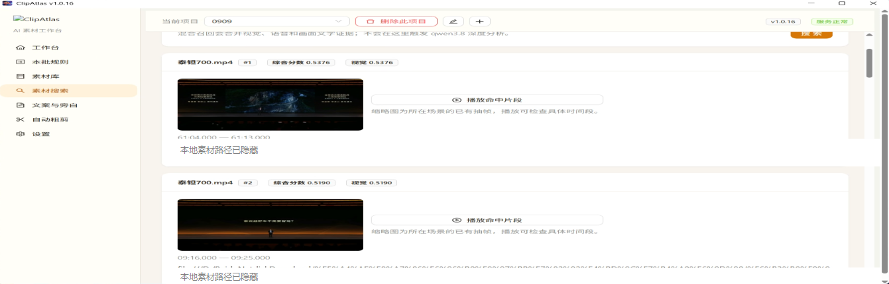
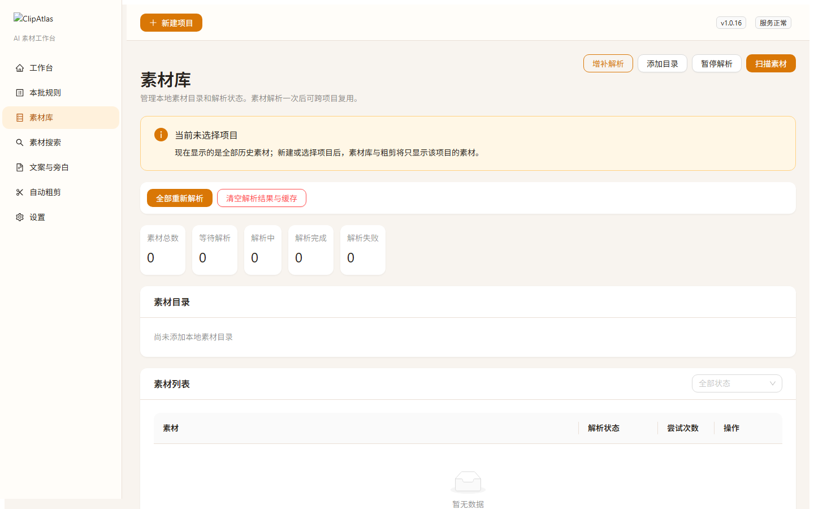
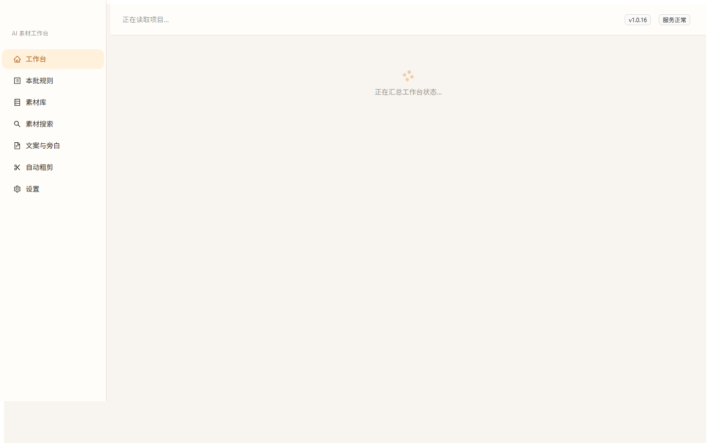
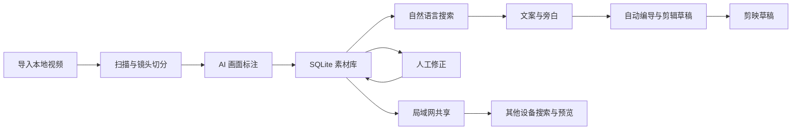
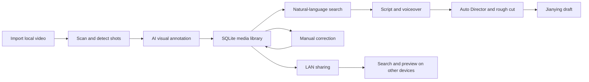

# ClipAtlas

[中文](#中文) | [English](#english)

## 中文

ClipAtlas 是一个本地优先的视频素材工作台。它可以导入本地视频、自动切分镜头、生成 AI 标注和搜索索引，并根据文案与旁白生成可继续编辑的剪辑草稿。

### 主要功能

- 批量导入本地视频并识别镜头和画面内容
- 按人物、动作、场景、画面文字或自然语言搜索素材
- 人工修正 AI 标注，并将修正结果用于后续搜索
- 管理文案、AI 配音和真人旁白
- 使用自动编导组织素材证据和故事简纲
- 根据旁白生成剪辑草稿并继续替换、裁切和调整素材
- 导出剪映草稿
- 通过局域网共享本机素材库，供其他设备只读搜索和预览
- 集成独立 Hypit 工作流，用于参考视频驱动的视频生成与编辑

### 软件截图

#### 素材搜索



搜索结果会显示命中画面、综合评分和源视频时间段，并可直接播放命中片段。

#### 素材库



素材库用于扫描目录、解析视频和查看处理状态。

#### 工作台



工作台集中显示当前项目、素材解析、旁白和剪辑草稿进度。

#### 局域网共享搜索


在保存标注数据的电脑上运行共享端后，其他电脑可以直接搜索和预览素材，无需复制素材库。

### 运行逻辑



### 从源码运行

要求：Python 3.12+、Node.js、FFmpeg 和 ffprobe。

```powershell
cd frontend
npm ci
npm run build
cd ..
pip install -e ".[dev]"
clipatlas
```

首次使用时，请在软件设置中填写自己的 AI API Key。本仓库不包含任何 API Key、视频素材、数据库、便携版运行数据或 Hypit 工作区。

Windows 安装包将在稳定版本验证完成后发布到 [Releases](https://github.com/xinsen854/ClipAtlas/releases)。

### 许可证

ClipAtlas 原创代码采用 **GNU Affero General Public License v3.0 或更高版本（AGPLv3-or-later）+ 单独商业授权** 的双许可证模式。

- 开源使用：遵守 [AGPLv3-or-later](LICENSE)。分发修改版或通过网络向用户提供修改版服务时，需要履行 AGPL 的源代码提供和版权声明义务。
- 商业使用：需要闭源集成、闭源分发或其他 AGPL 例外时，可联系版权所有者另行签署商业许可。仓库中的商业授权说明本身不自动授予商业权利，详见 [COMMERCIAL_LICENSE.md](COMMERCIAL_LICENSE.md)。
- 第三方代码：继续适用各自许可证，不因 ClipAtlas 的双许可证而改变，详见 [THIRD_PARTY_NOTICES.md](THIRD_PARTY_NOTICES.md)。

## English

ClipAtlas is a local-first video media workspace. It imports local videos, detects shots, creates AI annotations and search indexes, and generates editable rough cuts from scripts and voiceovers.

### Features

- Import local videos in batches and detect shots and visual content
- Search by people, actions, scenes, on-screen text, or natural language
- Correct AI annotations and use those corrections in later searches
- Manage scripts, AI-generated speech, and recorded voiceovers
- Organize media evidence and story outlines with Auto Director
- Generate editable rough cuts from the active voiceover
- Replace, trim, split, and adjust media before export
- Export Jianying drafts
- Share a local media library over a LAN for read-only search and preview
- Integrate a separate Hypit workflow for reference-driven video generation and editing

### Screenshots

#### Media search


Results include the matching frame, combined score, source time range, and direct segment playback.

#### Media library


The library scans folders, processes videos, and reports processing status.

#### Dashboard


The dashboard summarizes the active project, media processing, voiceover, and rough-cut progress.

#### LAN search


Run the sharing service on the computer that stores the indexed library. Other devices can then search and preview media without copying the library.

### Workflow



### Run from source

Requirements: Python 3.12+, Node.js, FFmpeg, and ffprobe.

```powershell
cd frontend
npm ci
npm run build
cd ..
pip install -e ".[dev]"
clipatlas
```

Enter your own AI API keys in Settings on first use. This repository does not include API keys, media files, databases, portable runtime data, or Hypit workspaces.

Validated Windows packages will be published on the [Releases](https://github.com/xinsen854/ClipAtlas/releases) page.

### License

Original ClipAtlas code is offered under a dual-license model: **GNU Affero General Public License v3.0 or later (AGPLv3-or-later) or a separate commercial license**.

- Open-source use: comply with [AGPLv3-or-later](LICENSE). Distributing a modified version or making a modified version available to users over a network may require providing the corresponding source code and preserving legal notices.
- Commercial use: contact the copyright holder for a separate written license if you need closed-source integration, closed-source distribution, or another exception to the AGPL. The commercial-license notice does not grant commercial rights by itself; see [COMMERCIAL_LICENSE.md](COMMERCIAL_LICENSE.md).
- Third-party code: remains under its original licenses and is not relicensed by the ClipAtlas dual-license model; see [THIRD_PARTY_NOTICES.md](THIRD_PARTY_NOTICES.md).
